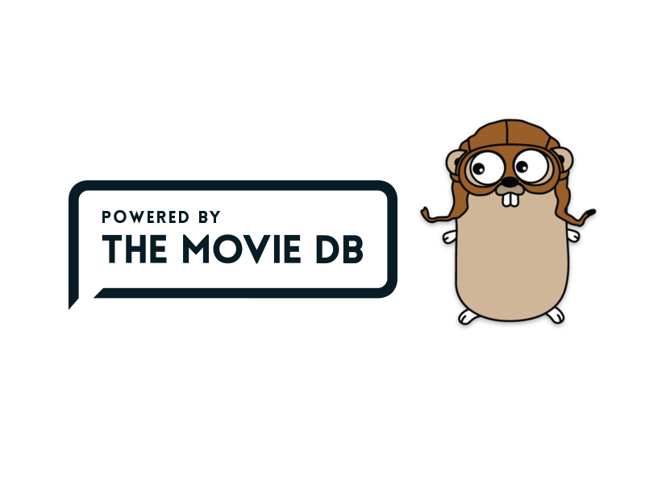

<p align="center"></p>

[](https://github.com/cyruzin/golang-tmdb/actions/workflows/build.yml) [](https://coveralls.io/github/cyruzin/golang-tmdb?branch=master) [](https://goreportcard.com/report/github.com/cyruzin/golang-tmdb) [](https://godoc.org/github.com/cyruzin/golang-tmdb)  [](https://github.com/Naereen/StrapDown.js/blob/master/LICENSE)

This is a Golang wrapper around the TMDb API.

An API Key is required. To register for one, head over to [themoviedb.org](https://www.themoviedb.org/).

This product uses the TMDb API but is not endorsed or certified by TMDb.

## Requirements

- Go 1.24.x or higher. We aim to support the latest supported versions of go.

## Installation

```sh
go get -u github.com/cyruzin/golang-tmdb
```

## Usage

To get started, import the `tmdb` package and create a new client:

```go
import "github.com/cyruzin/golang-tmdb"

// With API key (v3 authentication)
tmdbClient, err := tmdb.New(tmdb.WithAPIKey(os.Getenv("YOUR_APIKEY")))
if err != nil {
    fmt.Println(err)
}

// With bearer token (v4 authentication)
tmdbClient, err := tmdb.New(tmdb.WithBearerToken(os.Getenv("YOUR_BEARER_TOKEN")))
if err != nil {
    fmt.Println(err)
}

movie, err := tmdbClient.GetMovieDetails(297802, nil)
if err != nil {
    fmt.Println(err)
}

fmt.Println(movie.Title)
```

## Client Options

The client supports functional options for configuration:

```go
// Auto retry on rate limit (429 TOO MANY REQUESTS)
tmdbClient, err := tmdb.New(
    tmdb.WithAPIKey(os.Getenv("YOUR_APIKEY")),
    tmdb.WithAutoRetry(),
)

// Custom timeout (default is 10 seconds)
tmdbClient, err := tmdb.New(
    tmdb.WithAPIKey(os.Getenv("YOUR_APIKEY")),
    tmdb.WithTimeout(time.Second * 5),
)

// Alternate base URL (https://api.tmdb.org/3 instead of https://api.themoviedb.org/3)
tmdbClient, err := tmdb.New(
    tmdb.WithAPIKey(os.Getenv("YOUR_APIKEY")),
    tmdb.WithAlternateBaseURL(),
)

// Custom base URL (useful for testing)
tmdbClient, err := tmdb.New(
    tmdb.WithAPIKey(os.Getenv("YOUR_APIKEY")),
    tmdb.WithCustomBaseURL("http://localhost:3000"),
)

// Custom http.Client configuration
customClient := http.Client{
    Timeout: time.Second * 5,
    Transport: &http.Transport{
        MaxIdleConns:    10,
        IdleConnTimeout: 15 * time.Second,
    },
}
tmdbClient, err := tmdb.New(
    tmdb.WithAPIKey(os.Getenv("YOUR_APIKEY")),
    tmdb.WithHTTPClient(customClient),
)

// Session ID for authenticated endpoints
// https://developers.themoviedb.org/3/authentication/how-do-i-generate-a-session-id
tmdbClient, err := tmdb.New(
    tmdb.WithAPIKey(os.Getenv("YOUR_APIKEY")),
    tmdb.WithSessionID(os.Getenv("YOUR_SESSION_ID")),
)
```

## Request Options

Pass optional parameters to endpoints:

```go
options := map[string]string{
    "language":           "pt-BR",
    "append_to_response": "credits,images",
}

movie, err := tmdbClient.GetMovieDetails(297802, options)
if err != nil {
    fmt.Println(err)
}

fmt.Println(movie.Title)
```

## Helpers

Generate image and video URLs:

```go
options := map[string]string{
    "append_to_response": "videos",
}

movie, err := tmdbClient.GetMovieDetails(297802, options)
if err != nil {
    fmt.Println(err)
}

fmt.Println(tmdb.GetImageURL(movie.BackdropPath, tmdb.W500))
// Output: https://image.tmdb.org/t/p/w500/bOGkgRGdhrBYJSLpXaxhXVstddV.jpg
fmt.Println(tmdb.GetImageURL(movie.PosterPath, tmdb.Original))
// Output: https://image.tmdb.org/t/p/original/bOGkgRGdhrBYJSLpXaxhXVstddV.jpg

for _, video := range movie.Videos.Results {
    if video.Key != "" {
        fmt.Println(tmdb.GetVideoURL(video.Key))
        // Output: https://www.youtube.com/watch?v=6ZfuNTqbHE8
    }
}
```

For more examples, see the [examples](https://github.com/cyruzin/golang-tmdb/tree/master/examples) directory.

## Performance

Getting Movie Details:

| Iterations | ns/op    | B/op  | allocs/op |
| ---------- | -------- | ----- | --------- |
| 19         | 60886648 | 60632 | 184       |

Multi Search:

| Iterations | ns/op    | B/op   | allocs/op |
| ---------- | -------- | ------ | --------- |
| 16         | 66596963 | 107109 | 608       |

## Contributing

To start contributing, please check [CONTRIBUTING](https://github.com/cyruzin/golang-tmdb/blob/master/CONTRIBUTING.md).

### Tests

For local testing, just run:

```go
 go test -v
```

## License

MIT
